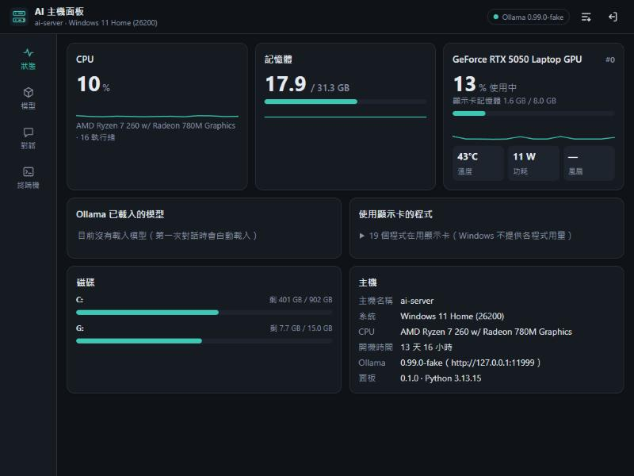
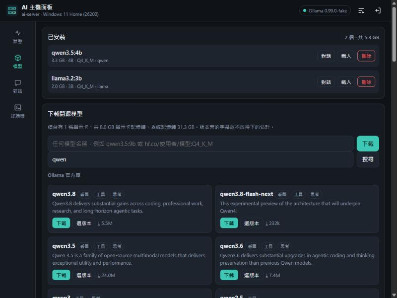
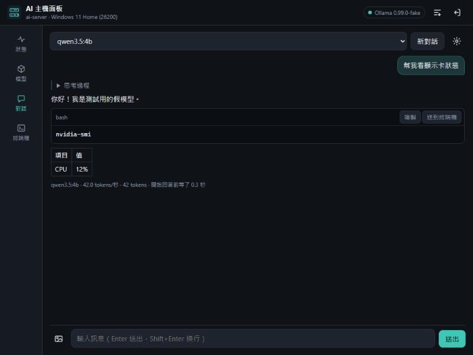
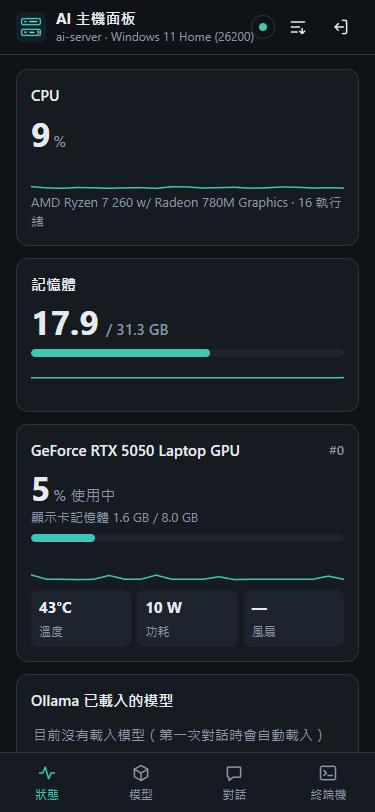
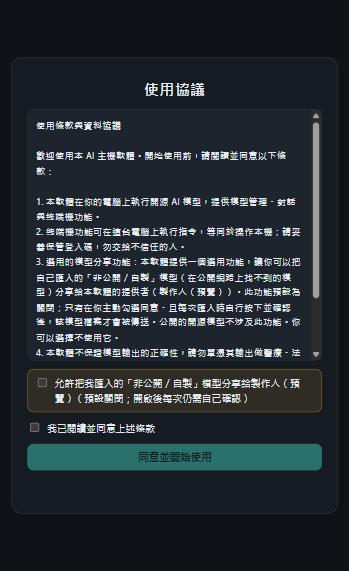

<div align="center">

# AI Server Kit

**Turn any computer into your own AI server — one click.**

Installs [Ollama](https://ollama.com), picks or imports open-source models, and gives you a clean, mobile-first web panel to watch the machine, manage models, chat with them, and run a terminal — all from your phone or another computer.

[](LICENSE)


-brightgreen.svg)


English · [繁體中文](README.zh-TW.md)



</div>

---

## What is it?

AI Server Kit is a single installer that sets up a **private, self-hosted AI machine**. Everyone and every company will soon run their own AI; this gets you there today, on hardware you already own.

- **One installer** — Windows (`安裝.bat` / `install.ps1`) or Linux (`install.sh`). It installs Ollama (you can pin a version), sets up the panel, and starts it on boot.
- **A web control panel** — pure Python standard library on the backend, pure JavaScript on the frontend. No Node, no pip packages, no build step. Works offline. Mobile-first, with a light/dark theme.
- **Private by default** — binds to `127.0.0.1`, protected by a login code. Nothing leaves the machine unless you explicitly ask it to.

## Features

| | |
|---|---|
| 📊 **Live status** | CPU, memory, every GPU (load, VRAM, temp, power, fan), disks, which models Ollama has loaded (and whether they fit in VRAM), and which processes use the GPU. |
| 🔎 **Search every open model** | One search box queries the **Ollama library** *and* **Hugging Face GGUF** models. Each size is tagged with "fits your GPU?"; Hugging Face results expand to pick a quantization. |
| 📥 **Import your own** | Local `.gguf`, split GGUF, or a safetensors folder — or upload a `.gguf` straight from your phone. The panel reads the GGUF header to identify the model first. |
| 💬 **Chat** | Talk to any installed model: thinking mode, vision (images), system prompt, and an optional "attach machine status" so the model can answer questions about the host. Code blocks have a one-click "send to terminal". |
| 🖥️ **Terminal** | CMD / PowerShell on Windows, bash on Linux. Remembers the working directory, survives phone lock and page reloads, and can be turned off for machines you hand to others. |
| 🔒 **Consent-first sharing** | Optional, off-by-default: a producer can receive a user's *non-public* model back — only after a signed agreement, an opt-in checkbox, and a per-model confirmation. Never automatic, never silent. |

## Screenshots

<div align="center">


<br>


</div>

## Quick start

### Windows 10 / 11 (or Server 2019+)

1. Download the latest release zip, unzip it anywhere on the machine.
2. Double-click **`安裝.bat`** and answer the prompts (press Enter for defaults):
   - Ollama version (Enter = latest; type `list` to see versions)
   - Allow phones / other computers on your network to connect?
   - Download a model now? (it recommends three based on your GPU)
3. The panel opens automatically and shows your **login code**.

Unattended / scripted:

```powershell
.\install.ps1 -Quiet -OllamaVersion 0.40.13 -Models qwen3.5:9b -Lan -ModelsDir D:\ollama-models
```

### Linux (Ubuntu / Debian / Fedora / RHEL, needs systemd)

```bash
sudo bash install.sh
```

Options mirror Windows: `--ollama-version`, `--model`, `--lan`, `--models-dir`, `--port`, `--no-terminal`, `--user`, `--yes`, `--list-versions`.

Forgot the login code? Windows: Start menu → AI 主機面板 → 顯示登入碼. Linux: `sudo /opt/ai-server-kit/show-token.sh`.

👉 **Full guide, deployment and usage:** **https://zoltan2007.github.io/ai-server-kit/**

## Kiki Cloude (`/studio/`)

A multi-user chat workspace on top of the panel, laid out like a desktop AI coding app: project list with groups and branches on the left, the conversation in the middle, a side pane on the right. The interface is in Traditional Chinese.

- **Accounts**: people apply on the login page (optionally verified by a code mailed to their Gmail address), an admin approves them, and each account gets its own projects. Admins can set daily or weekly token limits and see usage on a dashboard. The install-time login code remains the master admin: the login page asks for it directly until an admin account exists, and after that it sits behind "忘記密碼" (forgot password).
- **Projects**: streaming replies with thinking, Markdown, branching, pinning, per-project instructions that are sent to the local model on every turn, export as text, an AI-readable memory file, or a zip of everything.
- **Message actions**: copy, regenerate the last answer, edit and resend one of your own messages, find within the conversation, keyboard shortcuts (`Ctrl+/` lists them).
- **Attachments**: images (for vision models; downscaled to 1568 px), text and code files (UTF-8 or Big5), and PDFs. **PDF text is extracted in the browser; the original file never reaches the host.** Scanned or encrypted PDFs yield no text. Only the newest batch of images is re-sent each turn unless you pin a message's images.
- **Artifact pane**: open code blocks, whole answers and attachments on the right to copy, download or preview. HTML, SVG and Markdown previews **never run JavaScript and load nothing from outside** (HTML sits in a fully sandboxed frame).
- **Your own cloud AI as a third participant**: connect a Claude, OpenAI, Gemini or Grok API key and add it to a project next to the local model. It only ever receives conversation text: never host status, project instructions or images, and attachment contents only if you switch that on for the project. Keys stay on the host.
- **Rooms**: invite other accounts into a shared room; the AI answers only when mentioned.

Long documents need a long context: Ollama reads about 4096 tokens by default and silently drops the rest. The page asks for a larger context when a conversation is long (8192, 16384 or 32768, from a rough estimate); to pin one value for every request and avoid model reloads, set `"num_ctx": 32768` in `config.json`. Larger contexts use more VRAM.

## Security & privacy

- **Local only by default** (`127.0.0.1`). `-Lan` opens it to your LAN — unencrypted, so for home/office networks only. To reach it from outside, use a VPN such as Tailscale; never expose the port to the open internet.
- **Every API call needs the login code** (24 random characters, generated at install). It lives in the request header, not the URL and not a cookie.
- **The terminal is full machine control** at the panel account's permission level. For machines you hand to others, install with `-NoTerminal`.
- **Ollama stays bound to `127.0.0.1`** — the outside world reaches it only through the login-protected panel.

### The "return a model to the producer" feature is opt-in and off by default

When you distribute this kit to others, imported models are often their own private, unpublished work. This feature **never uploads in the background**. It takes three gates:

1. The producer sets a receive URL in `config.json` (`share.url`). Without it, the button never appears.
2. On first run, the user must accept a **usage agreement** that clearly discloses this optional sharing. Accepting only makes the button available — it never sends anything on its own.
3. Even then, each unknown model is only sent when the user clicks "import & return" and confirms. Public models are never involved.

The producer-side **receiver** (`receiver/`) is a tiny standalone server that accepts those uploads, verifies a token, stores them, and shows a listing page. See the [full docs](https://zoltan2007.github.io/ai-server-kit/).

> Not legal advice: what protects users here is that **no model is ever uploaded automatically** — each one needs an explicit per-model confirmation. Have a lawyer review the agreement text before relying on it commercially.

## How it works

The panel (`app/server.py`) is a threaded `http.server` with a small JSON API. It talks to Ollama's HTTP API for everything model-related, reads machine stats directly (ctypes on Windows, `/proc` on Linux, `nvidia-smi` for GPUs), and runs terminal commands / downloads / imports as cancellable background jobs that survive disconnects.

```
app/
  server.py       HTTP server, auth, routes
  sysinfo.py      CPU / RAM / disk / GPU
  jobs.py         background jobs: terminal, downloads, imports
  ollama_api.py   Ollama calls, model search, GGUF identify, return
  agreement.py    usage agreement + opt-in record
  catalog.json    curated model list (real sizes from the Ollama registry)
  web/            the panel UI (no external files)
receiver/         producer-side "receive a model" server
tests/            unittest suite (fake Ollama — no network, no GPU needed)
tools/            packaging, catalog refresh, local dev preview
```

## Development

```bash
# run the tests (uses a fake Ollama; no GPU or network needed)
python -m unittest discover -s tests

# local preview with a fake Ollama (panel on http://127.0.0.1:8781)
python tools/dev.py

# build a release zip into dist/
pwsh tools/pack.ps1
```

## Roadmap

- AMD / Intel GPU details (Ollama runs on them; the panel only shows NVIDIA stats today).
- Managing several hosts from one panel.
- Other engines (vLLM, llama.cpp) beyond Ollama.
- A single-file `.exe` installer.

## License

[MIT](LICENSE) © 2026 zoltan2007. Not affiliated with Ollama or Hugging Face.
