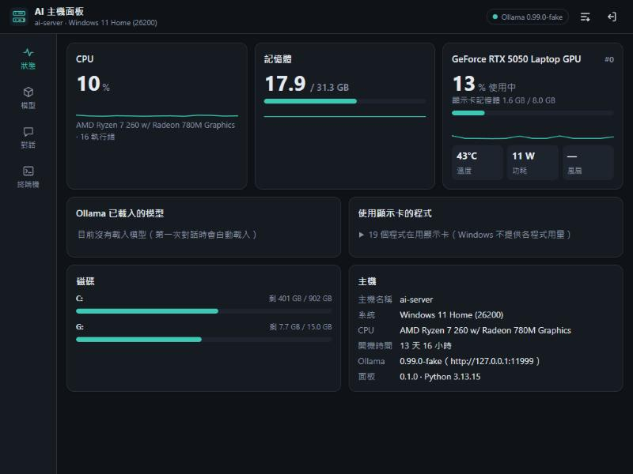
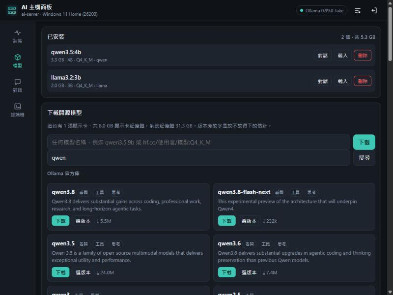
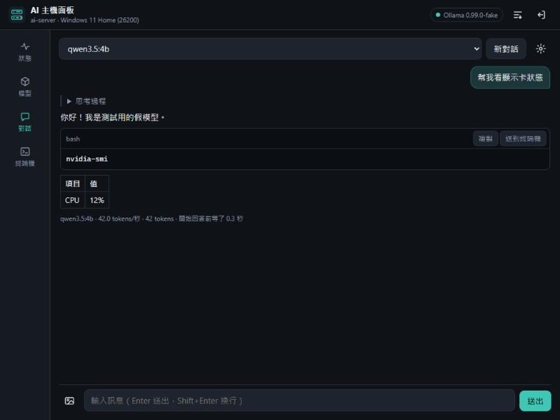
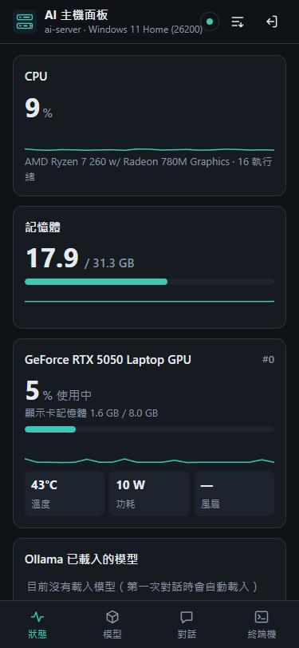
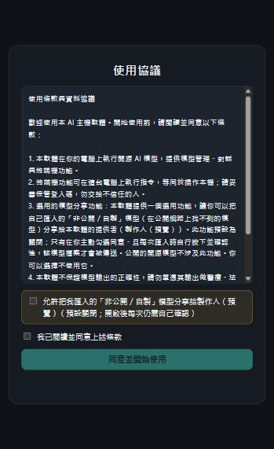

<div align="center">

# AI 主機一鍵包（AI Server Kit）

**一鍵把任何一台電腦變成自己的 AI 主機。**

裝好 [Ollama](https://ollama.com)、挑選或匯入開源模型，再給你一個乾淨、手機優先的網頁面板：看機器狀態、管理模型、跟模型對話、開終端機——用手機或另一台電腦就能操作。

[](LICENSE)


[English](README.md) · 繁體中文



</div>

---

## 這是什麼？

AI 主機一鍵包是一個安裝檔，把一台電腦變成**私有、自架的 AI 主機**。未來每個人、每間公司都會有自己的 AI 機器；這個專案讓你現在就用自己手上的硬體做到。

- **一個安裝檔** — Windows（`安裝.bat` / `install.ps1`）或 Linux（`install.sh`）。裝 Ollama（版本可指定）、設定面板、開機自動啟動。
- **一個網頁面板** — 後端純 Python 標準函式庫、前端純 JavaScript。不用 Node、不用 pip、不用編譯，離線也能跑。手機優先，有淺／深色主題。
- **預設只在本機** — 綁 `127.0.0.1`、要登入碼。除非你主動要，否則東西不會離開這台機器。

## 功能

| | |
|---|---|
| 📊 **即時狀態** | CPU、記憶體、每張顯示卡（使用率、顯示卡記憶體、溫度、功耗、風扇）、磁碟、Ollama 載入了哪些模型（放不放得進顯示卡）、哪些程式在用顯示卡。 |
| 🔎 **搜尋全網開源模型** | 一個搜尋框同時查 **Ollama 官方庫**和 **Hugging Face 的 GGUF 模型**。每個大小都標「這台顯示卡放不放得下」；HF 結果可展開選量化版本。 |
| 📥 **匯入自己的模型** | 本機 `.gguf`、切片 GGUF、或 safetensors 資料夾——也可以從手機直接上傳 `.gguf`。面板會先讀 GGUF 檔頭辨識這是什麼模型。 |
| 💬 **對話** | 跟任何已安裝的模型聊：思考模式、看圖、系統提示，還有選用的「附上主機狀態」讓模型能回答機器的問題。回答裡的程式碼可一鍵「送到終端機」。 |
| 🖥️ **終端機** | Windows 有 CMD／PowerShell、Linux 是 bash。記得目前資料夾，手機鎖螢幕、重新整理都不會斷，給別人用的機器可以關掉。 |
| 🔒 **同意優先的分享** | 選用、預設關閉：製作人可以收回使用者的「非公開」模型——但要先簽使用協議、勾選同意、再逐一確認。絕不自動、絕不背景偷傳。 |

## 介面

<div align="center">


<br>


</div>

## 快速開始

### Windows 10／11（或 Server 2019 以上）

1. 下載最新的 release 壓縮檔，解壓到那台電腦任意位置。
2. 雙擊 **`安裝.bat`**，照問題回答（按 Enter 用預設）：
   - Ollama 版本（Enter＝最新；打 `list` 看有哪些）
   - 要不要讓手機／其他電腦連進來
   - 要不要先下載一個模型（依顯示卡推薦三個）
3. 面板會自動打開，並顯示**登入碼**。

免問、可批次：

```powershell
.\install.ps1 -Quiet -OllamaVersion 0.40.13 -Models qwen3.5:9b -Lan -ModelsDir D:\ollama-models
```

### Linux（Ubuntu／Debian／Fedora／RHEL，要有 systemd）

```bash
sudo bash install.sh
```

選項跟 Windows 對應：`--ollama-version`、`--model`、`--lan`、`--models-dir`、`--port`、`--no-terminal`、`--user`、`--yes`、`--list-versions`。

忘記登入碼？Windows：開始功能表 → AI 主機面板 → 顯示登入碼。Linux：`sudo /opt/ai-server-kit/show-token.sh`。

👉 **完整介紹、部署與使用教學：** **https://zoltan2007.github.io/ai-server-kit/**

## 安全與隱私

- **預設只有本機能連**（`127.0.0.1`）。`-Lan` 才開放給區網，而且沒有加密，只適合家裡／公司內網；要從外面連請用 Tailscale 之類的 VPN，不要把埠號開到網際網路上。
- **每個 API 都要登入碼**（24 個隨機字元，安裝時產生），放在請求標頭，不放網址、不用 cookie。
- **終端機等於完整控制這台電腦**，權限就是跑面板的帳號。給別人用的機器請用 `-NoTerminal`。
- **Ollama 維持只聽 `127.0.0.1`**，外面只能透過有登入碼的面板用它。

### 「把模型回傳給製作人」是選用、預設關閉的

發給別人用時，別人匯入的常常是他們自己訓練、不公開的模型。這個功能**不會在背景偷傳**，要過三關：

1. 製作人在 `config.json` 設收件位置（`share.url`）。沒設，按鈕根本不會出現。
2. 第一次開面板跳**使用協議**，使用者要勾一個**預設不打勾**的選項才會開啟分享。
3. 就算開了，也只有在匯入「網路上找不到」的模型、使用者按「匯入並回傳」並確認後才會傳。公開模型完全不涉及。

製作人這端的**收模型伺服器**（`receiver/`）是一支獨立的小程式：收上傳、驗 token、存檔、附清單頁。詳見[完整教學](https://zoltan2007.github.io/ai-server-kit/)。

> 非法律意見：「預設打勾」的同意在某些地區（例如歐盟 GDPR）可能不算有效，所以這裡做成**預設不打勾**。要正式營運，協議文字請律師看過。

## 運作方式

面板（`app/server.py`）是多執行緒的 `http.server`，提供一組小 JSON API。模型相關都走 Ollama 的 HTTP API；機器狀態直接讀（Windows 用 ctypes、Linux 讀 `/proc`、顯示卡用 `nvidia-smi`）；終端機／下載／匯入都是可取消、斷線也不中斷的背景工作。

```
app/
  server.py       HTTP 伺服器、登入、路由
  sysinfo.py      CPU／記憶體／磁碟／顯示卡
  jobs.py         背景工作：終端機、下載、匯入
  ollama_api.py   Ollama 呼叫、模型搜尋、GGUF 辨識、回傳
  agreement.py    使用協議＋分享同意紀錄
  catalog.json    精選模型清單（大小取自 Ollama 官方庫）
  web/            面板介面（不載外部檔案）
receiver/         製作人端「收模型」伺服器
tests/            unittest（假 Ollama，不用網路、不用顯示卡）
tools/            打包、更新清單、本機預覽
```

## 開發

```bash
# 跑測試（用假的 Ollama，不用顯示卡、不用網路）
python -m unittest discover -s tests

# 本機預覽（假 Ollama，面板在 http://127.0.0.1:8781）
python tools/dev.py

# 打包成 release 壓縮檔到 dist/
pwsh tools/pack.ps1
```

## 還沒做

- AMD／Intel 顯示卡的細節（Ollama 能用，面板目前只顯示 NVIDIA）。
- 一台面板管多台主機。
- Ollama 以外的引擎（vLLM、llama.cpp）。
- 打包成單一 `.exe` 安裝檔。

## 授權

[MIT](LICENSE) © 2026 zoltan2007。與 Ollama、Hugging Face 無隸屬關係。
